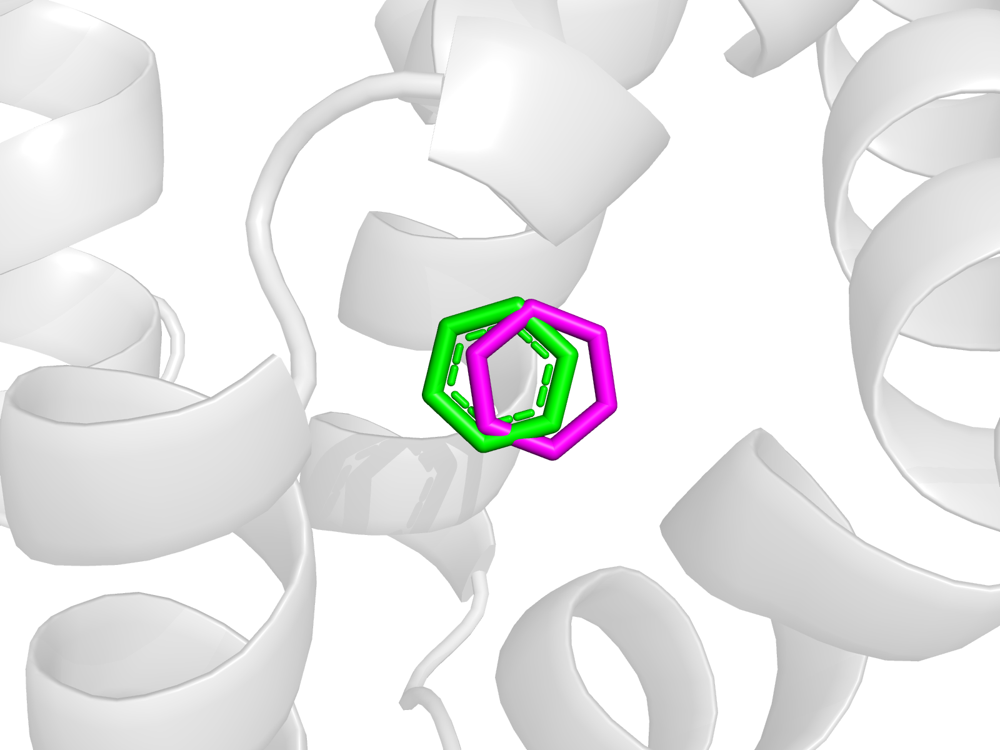
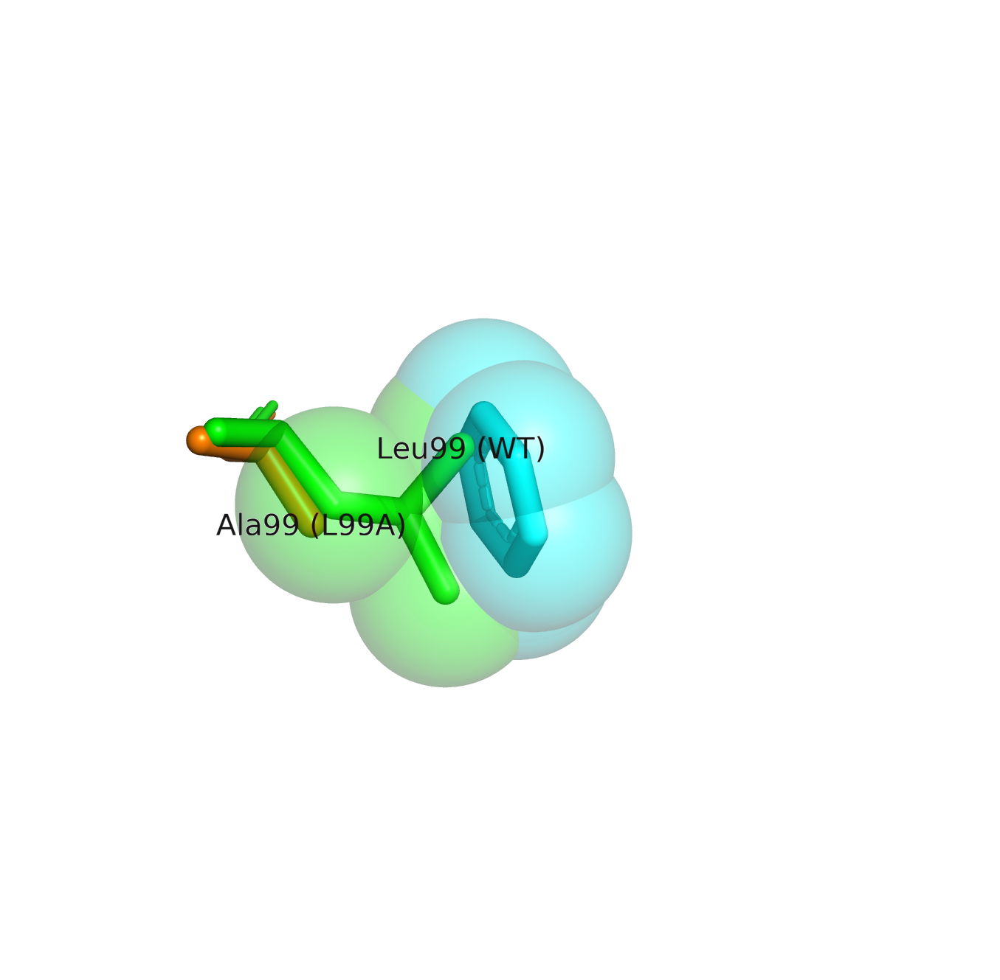
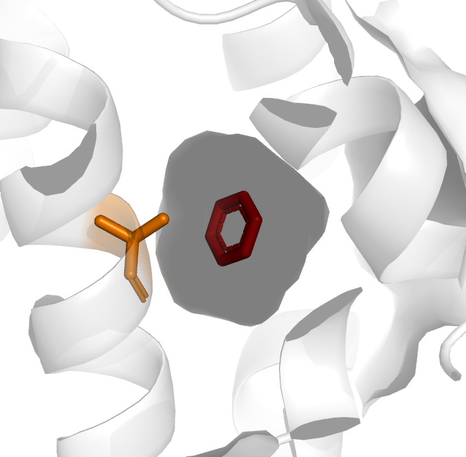

# Cavity-creating mutation and ligand binding: docking benzene to wild-type and L99A T4 lysozyme

A small structure-based docking study (AutoDock Vina), built as a self-study project after a molecular docking workshop and reproducible from the prepared inputs included in this repository. It asks a simple question:

> If a mutation changes a protein's binding pocket, can a ligand still bind, or can it newly bind?

**Author:** Kamal Alavi; **Tools:** AutoDock Vina 1.1.2, AutoDockTools 1.5.7 (with its bundled Python 2.7.11), UCSF Chimera 1.20, PyMOL 3.1.7, Avogadro 2.1.0

---

## Why this system

The C-terminal domain of T4 lysozyme has a tightly packed hydrophobic core. In the **L99A** mutant, Leu99 is replaced by the much smaller Ala, which creates an engineered buried hydrophobic cavity that binds benzene and similar small hydrophobic molecules. The protein without this mutation has no such cavity and does not bind benzene there (Eriksson et al. 1992; Morton and Matthews 1995). Because the experimental answer is known, this system is a good test of a docking workflow: a correct workflow should place benzene in the L99A cavity and should *not* find the cavity usable in the wild-type protein.

| Role | PDB ID | Description |
|---|---|---|
| Mutant + crystallographic ligand | [181L](https://www.rcsb.org/structure/181L) | T4 lysozyme L99A with benzene bound (on the cysteine-free C54T/C97A background) |
| Wild type | [2LZM](https://www.rcsb.org/structure/2LZM) | Native (cysteine-containing) T4 lysozyme. Sequence comparison with the L99A structure (`scripts/compare_seq.py`) shows **three** differences, not one: C54T and C97A (the cysteine-free "pseudo-wild-type" background carried by the L99A file) plus L99A. The comparison is therefore not a single-point-mutation pair; C54T/C97A are present only in the L99A structure. |

---

## Key results

| Receptor | Best affinity, 5 seeds (kcal/mol) | Poses inside the cavity | Where the other poses go |
|---|---|---|---|
| **L99A** (181L) | **-5.5 ± 0.0** (identical in all 5 seeds) | 34 of 45 modes (6 to 8 per run, always the top-ranked ones) | 9 to 12 Å away, on the surface (affinity -3.2 to -3.3) |
| **Wild type** (2LZM) | **-3.6 ± 0.0** (identical in all 5 seeds) | **0 of 45 modes** | all 9 to 12 Å away, on the surface (affinity -3.5 to -3.6) |

* **Redocking validation (L99A, seed 1):** the docked benzene reproduced the crystallographic pose with RMSD 0.94 to 1.01 Å for modes 1 to 8 (centroid shift 0.8 Å). Mode 9, outside the cavity, was 9.2 Å away and had a worse score (-3.2).
* **Why the wild type fails:** when benzene is placed at its crystallographic position in the aligned wild-type structure, the only protein atoms within 2.0 Å are three atoms of **Leu99** (CG, CD1, CD2). The Leu99 side chain occupies the space the ligand needs.
* **Reading the scores:** surface sites score about -3.2 to -3.6 in both proteins. The ~1.9 kcal/mol gap between the best poses (-5.5 vs -3.6) is consistent with a cavity-specific contribution, but it is smaller than Vina's typical error (about 2.85 kcal/mol in Trott and Olson 2010), so the score difference alone is not convincing; the pose locations and the steric clash are what make the result persuasive.

## Figures


*Figure 1. Redocking of benzene into L99A. green = crystallographic benzene (181L), magenta = Vina mode 1, RMSD 0.99 Å.*


*Figure 2. Benzene at its crystallographic position (cyan) overlaps the Leu99 side chain of the wild type (green spheres). The backbone of Ala99 in L99A (orange sticks) superimposes on the wild-type backbone, so the two structures are well aligned.*


*Figure 3. The cavity of L99A with benzene and Ala99. orange = Ala99, red = benzene.*

---

## Methods

1. **Structures** were downloaded from the RCSB PDB (181L and 2LZM).
2. **Receptor cleaning (UCSF Chimera, version 1.20):** crystallographic benzene was saved separately as the reference pose (`BNZ_crystal.pdb`), then benzene, water, and any other non-protein atoms were removed.
3. **Sequence comparison (PyMOL, `scripts/compare_seq.py`):** the sequences of the cleaned 2LZM and 181L chains were compared position by position. The 2LZM chain has 164 residues (numbered 1 to 164) and the 181L chain has 162 (numbered 1 to 162, no internal gaps), so residues 163 and 164 are absent from the 181L file; over residues 1 to 162 the only mismatches are C54T, C97A and L99A.
4. **Superposition (PyMOL, version 3.1.7):** the wild-type structure was aligned onto L99A (`align`) so that a single docking box can be used for both.
5. **Receptor PDBQT (AutoDockTools, version 1.5.7):** polar hydrogens added, Kollman charges assigned, non-polar hydrogens merged.
6. **Ligand (Avogadro, version 2.1.0):** benzene built from SMILES `c1ccccc1`, hydrogens added, geometry optimised (force field: MMFF94), converted to PDBQT in AutoDockTools (no rotatable bonds; AutoDockTools default charges (Gasteiger), which Vina does not use in scoring). The ligand was **not** taken from the crystallographic pose, so the redocking test is not biased.
7. **Search box:** centre (26.9075, 6.135, 4.1855) Å, the midpoint of the extent of the crystallographic benzene; size 20 × 20 × 20 Å. The same box was used for both receptors.
8. **Docking (AutoDock Vina, version 1.1.2, `vina.exe --version`):** exhaustiveness 16, 9 modes, random seeds 1 to 5, for each receptor (10 independent runs).
9. **Analysis (PyMOL scripts in `scripts/`):**
   * `rmsd_pymol.py`: RMSD between each docked pose and the crystallographic benzene.
   * `locate.py`: distance from the centre of every pose (all seeds, both receptors) to the centre of the crystallographic benzene, used to decide whether a pose is inside the cavity.
      * `compare_seq.py`: sequences of the cleaned 2LZM and 181L chains were compared position by position. The files have 162 and 164 residues; the only mismatches are C54T, C97A and L99A.
   * Steric clash: `select clash, wt within 2.0 of bnz` in PyMOL with the aligned wild type and the crystallographic benzene loaded.

## Repository layout

```
lysozyme-benzene-docking/
├── README.md
├── LICENSE
├── structures/   181L.pdb, 2LZM.pdb (from the RCSB PDB)
├── prepared/     cleaned/aligned proteins, PDBQT inputs, crystallographic benzene
├── config/       conf.txt (box and search settings)
├── scripts/      rmsd_pymol.py, locate.py, compare_seq.py
├── results/      all Vina logs (.log) and docked poses (.pdbqt), 5 seeds x 2 receptors
└── figures/      figures used in this README
```

## Reproducing the docking

AutoDock Vina is not included; download it from the AutoDock Vina releases page. On Windows, from the repository root (Command Prompt):

```
vina.exe --config config\conf.txt --receptor prepared\L99A.pdbqt --ligand prepared\benzene.pdbqt --out results\L99A_s1.pdbqt --seed 1 > results\L99A_s1.log
vina.exe --config config\conf.txt --receptor prepared\WT.pdbqt  --ligand prepared\benzene.pdbqt --out results\WT_s1.pdbqt  --seed 1 > results\WT_s1.log
```

Change `--seed` (1 to 5) and the output names for the other runs. Then open PyMOL and run `run scripts/rmsd_pymol.py` and `run scripts/locate.py`.

## Limitations

* **Confounded wild-type/mutant pair.** 2LZM is the native cysteine-containing enzyme, while 181L is L99A on the cysteine-free C54T/C97A background, so the two structures differ at three positions. In 181L, residue 97 is 8.1 Å (closest heavy atoms) from the crystallographic benzene, and its CB is 7.3 Å from the CB of residue 99, so it does not contact the ligand directly; the effect of C54T/C97A on the pocket was nevertheless not tested. A cleaner control would be a cysteine-free pseudo-wild-type structure (e.g. 1L63).
* **Holo receptor.** The L99A receptor comes from the benzene-bound structure with the ligand removed, so the cavity is already shaped for benzene. Pose recovery is therefore easier than with an apo structure.
* **Known binding site.** The search box is centred on the crystallographic benzene, so this is not a blind-docking test of cavity discovery.
* **Rigid receptor.** Vina treated the protein as rigid. Real L99A and wild-type lysozyme breathe; the wild-type result says "no room in this static structure", not "no binding is possible".
* **One ligand only.** No known binders or non-binders were docked as controls, so this study cannot say how well the protocol ranks different compounds.
* **Scoring accuracy.** Vina's error is of the order of 2.85 kcal/mol (Trott and Olson 2010); scores are not dissociation constants. Identical scores across seeds mean the search converged, not that the score is exact (scores are reported to 0.1 kcal/mol).
* **Symmetry in RMSD.** Benzene is symmetric, so the RMSD uses the best match of the six ring carbons over all 720 permutations. Only 12 of these preserve ring connectivity, so the reported RMSD values are a lower bound relative to a strictly symmetry-aware calculation.
* **No waters, no dynamics, no experimental validation** were performed by the author.

## References

1. Trott O, Olson AJ. AutoDock Vina: improving the speed and accuracy of docking with a new scoring function, efficient optimization and multithreading. *J Comput Chem* 2010;31:455-461.
2. Morton A, Matthews BW. Specificity of ligand binding in a buried nonpolar cavity of T4 lysozyme: Linkage of dynamics and structural plasticity. *Biochemistry* 1995;34(27):8576-88.
3. Eriksson AE, Baase WA, Wozniak JA, Matthews BW. A cavity-containing mutant of T4 lysozyme is stabilized by buried benzene. *Nature* 1992;355:371-373.
4. RCSB Protein Data Bank entries 181L and 2LZM.

## License

Scripts: MIT License. Structure files are public-domain data from the RCSB PDB.
